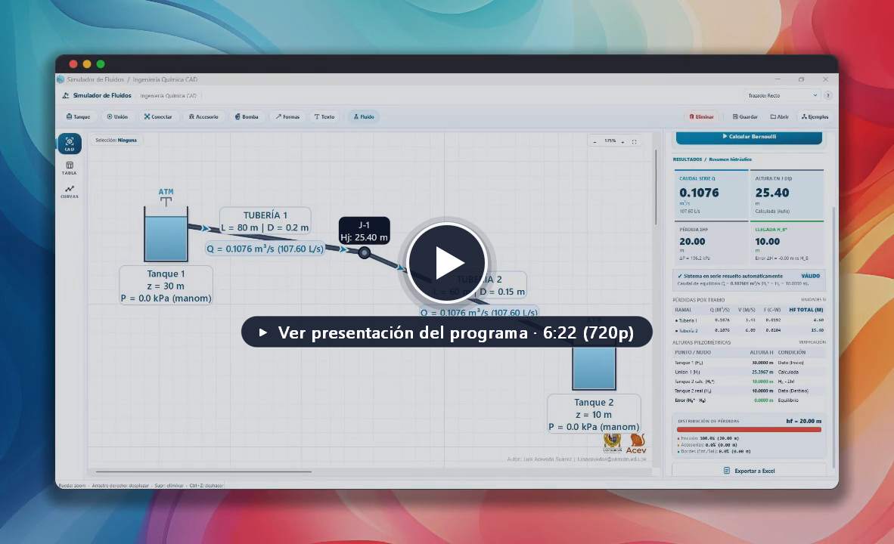

# Simulador de flujo de fluidos

Proyecto dividido en módulos por responsabilidad para diseño y análisis hidráulico de redes de tuberías y sistemas de bombeo en entorno CAD.

<p align="center">
  <a href="https://github.com/luisacevedo15/Simulador-de-fluidos/releases/latest/download/Simulador.Flujo.de.Fluidos.exe">
    
  </a>
  &nbsp;
  <a href="https://github.com/luisacevedo15/Simulador-de-fluidos/archive/refs/heads/main.zip">
    
  </a>
  &nbsp;
  <a href="https://github.com/luisacevedo15/Simulador-de-fluidos/raw/main/presentacion/Presentacion_720.mp4">
    
  </a>
</p>

## Presentación del programa

<p align="center">
  <a href="https://github.com/luisacevedo15/Simulador-de-fluidos/raw/main/presentacion/Presentacion_720.mp4">
    
  </a>
</p>

<p align="center">
  <a href="https://github.com/luisacevedo15/Simulador-de-fluidos/raw/main/presentacion/Presentacion_720.mp4">▶ Reproducir o descargar video de presentación (720p, 6:22 min)</a>
  &nbsp;·&nbsp;
  <a href="presentacion/Presentacion_720.mp4">Ver archivo en el repositorio</a>
</p>

## Descarga rápida (si no usas Git)

- **Opción recomendada (Windows, sin instalar Python):** haz clic en **Descargar para Windows (.exe)** arriba para descargar directamente `Simulador.Flujo.de.Fluidos.exe` (también disponible en [Releases](https://github.com/luisacevedo15/Simulador-de-fluidos/releases/latest)) y ejecútalo.
  > **Nota sobre Windows Defender / SmartScreen:** como es un ejecutable compilado con PyInstaller sin certificado comercial de firma digital, Windows puede mostrar el aviso preventivo *"Windows protegió su PC"*. Si aparece, haz clic en **Más información → Ejecutar de todas formas** (o usa la opción de código fuente con Python si prefieres inspeccionar y ejecutar el código directamente).
- **Opción con código fuente:** haz clic en **Descargar Código (.zip)** arriba, descomprime la carpeta en tu equipo y sigue la sección [Ejecutar](#ejecutar).

## Estructura

```text
Simulador-de-fluidos/
├── main.py                              Punto de entrada (ejecutar este archivo)
├── build_exe.py                         Compilación de ejecutable con PyInstaller
├── Simulador_Flujo_de_Fluidos.spec      Especificación de empaquetado PyInstaller
├── requirements.txt                     Dependencias del proyecto
├── presentacion/                        Video de presentación y recursos gráficos del README
│   ├── Presentacion_720.mp4             Video de presentación (720p, optimizado para GitHub)
│   ├── portada_presentacion.png         Miniatura del video con botón de reproducción
│   └── btn_*.png                        Botones de descarga y acceso rápido del README
├── motor/                               Cálculo hidráulico en SI (sin interfaz gráfica)
│   ├── motor_fluidos.py                 Clase MotorFluidos (une fricción, redes, bombas y ramificadas)
│   ├── friccion.py                      Darcy-Weisbach, Colebrook (-0.86·ln), Kármán, cálculo de Q y D
│   ├── hidraulica.py                    Evaluación de tramos y desglose de accesorios (K y Le/D)
│   ├── numerica.py                      Bisección, tolerancias numéricas y control de salto en Re=2000
│   ├── validacion.py                    Validación de dominio en unidades SI
│   ├── redes.py                         Redes ramificadas, doble nudo y serie por energía
│   ├── bombas.py                        Bombas centrífugas, curvas H-Q, series, paralelo, NPSH y Pv
│   ├── bomba_ramificada.py              Bombas en redes ramificadas (balance en nudo j)
│   ├── curvas.py                        Muestreo SI de curvas
│   ├── perfiles.py                      Perfiles físicos EGL/HGL desde resultados resueltos
│   ├── resultados.py                    Contratos inmutables de resultados en SI
│   └── ejecucion.py                     Historial privado por ejecución mediante ContextVar
├── ui/                                  Interfaz gráfica (PyQt5)
│   ├── constantes.py                    Factores SI, textos y tema visual
│   ├── catalogo_accesorios.py           Catálogo de accesorios (Válvula, Reducción, Expansión)
│   ├── recursos.py                      Ruta a logos e íconos
│   ├── iconos.py                        Dibujo de los íconos de herramientas
│   ├── reportes.py                      Componentes HTML de los reportes
│   ├── widgets.py                       Widgets auxiliares
│   ├── dialogos.py                      Diálogos de fluido y de suposiciones
│   ├── escena.py                        Escena y vista del lienzo CAD
│   ├── perfil_egl.py                    Gráfico de la línea de energía (EGL/HGL)
│   ├── graficos.py                      Tanques, tuberías, accesorios, nodos y textos
│   └── ventana/                         Ventana principal, separada en mixins
│       ├── principal.py                 MainWindow (une todos los mixins)
│       ├── interfaz.py                  Construcción de paneles, lienzo y cabecera
│       ├── estilos.py                   Hoja de estilos
│       ├── barra_herramientas.py        Barra de herramientas y normalización del fluido
│       ├── vistas.py                    Vistas CAD / TABLA / CURVAS
│       ├── panel_propiedades.py
│       ├── dashboard.py
│       ├── resolucion.py                Tuberías en serie y en paralelo
│       ├── ramificadas.py               Uniones ramificadas y doble nudo
│       ├── bernoulli.py
│       ├── exportacion.py               Exportar a Excel
│       └── memoria_calculo.py           Hojas de memoria de cálculo
└── tests/                               Suite de pruebas (pytest) y casos golden en tests/golden/
```

## Ejecutar

Desde la raíz del proyecto (`Simulador-de-fluidos/`):

```bash
python -m pip install -r requirements.txt
python main.py
```

Los archivos de imagen (`logo_1.ico`, `logo_2.jpg`, `logo_3.png`) deben estar en la raíz del proyecto, al lado de `main.py`.

Se requiere Python 3.10 o posterior. `requirements.txt` incluye PyQt5 (interfaz), numpy (curvas de bombas), XlsxWriter (exportación), openpyxl (vista previa y verificación de Excel), pyinstaller (compilación con `python build_exe.py`) y pytest (tests). No se necesita SciPy.

Para verificar el proyecto sin crear ventanas:

```powershell
python -m pytest -q
```

## Criterios hidráulicos y consideraciones del simulador

### 1. Ecuación de Colebrook–White y Kármán (`-0.86 · ln` frente a `-2 · log₁₀`)

- **Forma estándar de literatura (base 10):** la ecuación clásica de Colebrook–White es:

  ```text
  1 / √f = -2 · log₁₀( (ε/D) / 3.7 + 2.51 / (Re · √f) )
  ```

  Al convertir `log₁₀(u) = ln(u) / ln(10)`, el coeficiente teórico exacto con logaritmo natural es `-2 / ln(10) ≈ -0.8686` (`-0.86858896...`).
- **Convención adoptada en este simulador:** tanto el motor de cálculo (`motor/friccion.py`) como las fórmulas escritas en los reportes de Excel (`ui/ventana/memoria_calculo.py`) emplean de forma uniforme el coeficiente redondeado **`-0.86`** con logaritmo natural:

  ```text
  x = -0.86 · ln( (ε/D) / 3.7 + 2.51 · x / Re ),    con x = 1 / √f  →  f = 1 / x²
  ```

  Esta convención produce un factor de fricción `f` ligeramente distinto al obtenido con `-2 · log₁₀(...)`, pero mantiene coherencia exacta entre la interfaz, el motor numérico y las hojas de memoria de cálculo (`-0.86*LN(...)`).
- **Número de Kármán como estimación inicial:** `calcular_Q_karman` también utiliza `-0.86 · ln((ε/D)/3.7 + 2.51/Ka)` con `Ka = (D·ρ/μ) · √(2·g·hf / (L/D + ΣLe/D))` únicamente como semilla; `calcular_Q` siempre corrige después mediante bisección usando la ley real completa.

### 2. Transición laminar–turbulento (salto en `Re = 2000`)

- **Criterio de régimen:** `RE_LIMITE_LAMINAR = 2000`. Para `Re < 2000` se aplica la ley laminar exacta (`f = 64 / Re`), y desde `Re >= 2000` se aplica directamente Colebrook (`-0.86 · ln(...)`), **sin zona de transición ni interpolación** para el cálculo de `f`.
- La constante `RE_LIMITE_TURBULENTO = 4000` solo se usa en `clasificar_regimen(Re)` para etiquetar visualmente `Laminar`, `Transición` (`2000 <= Re < 4000`) o `Turbulento`.
- **Discontinuidad física:** con `ε/D = 0`, el factor `f` salta aproximadamente de `0.032` a `0.050` al cruzar `Re = 2000`. Si una pérdida objetivo `hf` cae dentro de ese hueco, el solver por bisección no fuerza un resultado suavizando la curva, sino que reporta falta de convergencia (`SIN_CONVERGENCIA` / `salto_regimen`).

### 3. Ecuación de Darcy–Weisbach y pérdidas localizadas (`K` y `Le/D`)

- Las pérdidas de carga se calculan por separado en `motor/friccion.py` como:

  ```text
  hf_dist = f · (L / D) · v² / (2g)
  hf_loc  = (f · Σ(Le/D) + ΣK) · v² / (2g)
  hf      = hf_dist + hf_loc
  ```

- Los coeficientes `K` y las longitudes equivalentes `Le/D` se mantienen independientes: **`K` no se convierte a `Le/D`** usando un factor de fricción fijo.

### 4. Constantes físicas, fluido por defecto y presión de vapor

- **Gravedad estándar:** fija en `g = 9.81 m/s²` (`MotorFluidos.g`).
- **Fluido por defecto en interfaz y migración de archivos:** agua a `20 °C` con `ρ = 1000.0 kg/m³`, `μ = 0.001 Pa·s`, `P_atm = 101325.0 Pa` y `P_vap = 2337.0 Pa` (`ui/ventana/principal.py`, `ui/dialogos.py`, `ui/ventana/barra_herramientas.py`). Al invocar de forma aislada ciertos métodos auxiliares del motor sin especificar fluido, `resolver_bomba_ramificada` toma por defecto `μ = 1.004e-3 Pa·s` y `carga_requerida_sistema` toma `μ = 0.001002 Pa·s`.
- **Presión de vapor del agua (`P_vap`):** `MotorFluidos.presion_vapor_agua` cubre `0–100 °C` mediante interpolación lineal sobre una tabla experimental estándar en mmHg convertida con `1 mmHg = 133.322 Pa`. La temperatura solo se utiliza para inicializar el fluido o migrar archivos JSON antiguos sin `P_vap`; los solvers trabajan siempre con las presiones absolutas explícitas `P_atm` y `P_vap`.

### 5. Unidades SI, convención de signos y variables desconocidas

- **Sistema Internacional puro:** el motor recibe y devuelve magnitudes en SI (`m`, `m³/s`, `Pa`, `kg/m³`, `Pa·s`, `m/s²`) y rechaza `NaN`, infinitos, booleanos y valores fuera de dominio (`L, D, rho, mu, g > 0`; `eps, K, Le/D >= 0`).
- **Caudal `Q >= 0`:** el caudal es siempre una magnitud no negativa; un `Q < 0` de entrada se rechaza en lugar de convertirse con valor absoluto. La dirección del flujo se declara aparte según la topología (`inicio → fin` en serie, `aspiración → descarga` en bombas, y `Entra a la unión` / `Sale de la unión` en ramales). Con `Q = 0` se devuelve `f = None` y `hf = 0`.
- **Diámetro incógnita (`D = 0`) e historial de diseño:** en la UI y el JSON, `D = 0` representa un diámetro por resolver únicamente cuando existe un `Q > 0` conocido y carga disponible (`calcular_D`); los métodos del motor que requieren diámetro conocido rechazan `D <= 0`. Al guardar proyectos se persisten `_q_por_energia` y `_d_por_energia` (en archivos antiguos sin esos campos se leen como `false`).
- En serie por energía (`resolver_serie_por_energia`), si `H_inicio < H_fin` la tubería se rechaza con `ORIENTACION_INVERTIDA`.

### 6. Bombas centrífugas, cavitación (NPSH) y tolerancias numéricas

- **Curvas `H-Q` y `η-Q` (`motor/bombas.py`):** se ajustan mediante polinomio cuadrático por mínimos cuadrados (`numpy.polyfit` grado 2 con 3 o más puntos; lineal con 2 puntos) o interpolación lineal por tramos (`lineal` / `interpolacion`). Las eficiencias ingresadas en `0–1` o `0–100 %` se normalizan y acotan en `[0, 1]`. En curvas con zona ascendente ("joroba"), la resolución restringe la búsqueda a la rama decreciente a partir de `Q_vertice`.
- **Cavitación y potencia:** `NPSHr(Q)` se interpola linealmente entre puntos de catálogo (saturado en los extremos) y `NPSHd` se calcula con presiones absolutas explícitas:

  ```text
  NPSHd = (P_atm + P₁ - P_vap) / (ρ · g) + z₁ - z_bomba - hf_succión
  ```

  Se marca `RIESGO DE CAVITACIÓN` cuando `NPSHd <= NPSHr`. La potencia al freno (`BHP`) solo se informa si todas las bombas activas cuentan con eficiencia válida `η > 0`.
- **Tolerancias y trazabilidad:**
  - Colebrook (`motor/friccion.py`): máximo `100` iteraciones de punto fijo, exigiendo simultáneamente `|x_nuevo - x| < 1e-12` y residuo relativo `<= 1e-8`.
  - Bisección (`motor/numerica.py`): `TOLERANCIA_RELATIVA = 1e-8`, `TOLERANCIA_INTERNA = 1e-11`, `MAX_ITERACIONES = 200`, comprobando el residuo físico real antes de aceptar la raíz.
  - Bombas en redes ramificadas (`motor/bomba_ramificada.py`): balance iterativo en el nudo `j` hasta tolerancia relativa `1e-8` (con piso absoluto `1e-15 m³/s` y máximo `100` iteraciones).
  - La curva del sistema ramificado valida masa y energía a `1e-8` relativo y devuelve estado y diagnóstico por punto; agotar un límite de búsqueda nunca equivale a converger.
  - Cada ejecución mantiene su propio `historial_iteraciones` aislado mediante `contextvars.ContextVar`, sin listas mutables compartidas en `MotorFluidos`.

## Dónde tocar cada cosa

- Cambiar una fórmula de pérdidas → `motor/friccion.py`
- Cambiar cómo se resuelve una red simple o ramificada → `motor/redes.py` o `ui/ventana/resolucion.py` / `ui/ventana/ramificadas.py`
- Cambiar bombas o cálculo de bombas en redes ramificadas → `motor/bombas.py` y `motor/bomba_ramificada.py`
- Cambiar colores o tamaños → `ui/constantes.py` y `ui/ventana/estilos.py`
- Cambiar cómo se dibuja un accesorio o bomba → `ui/graficos.py`
- Cambiar el panel de propiedades → `ui/ventana/panel_propiedades.py`
- Cambiar memorias de cálculo en Excel → `ui/ventana/memoria_calculo.py` y `ui/ventana/exportacion.py`
